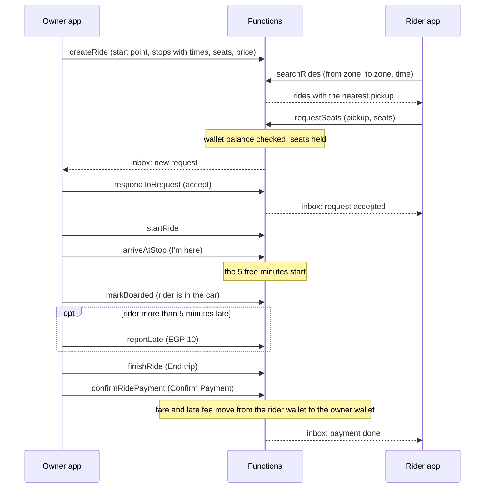
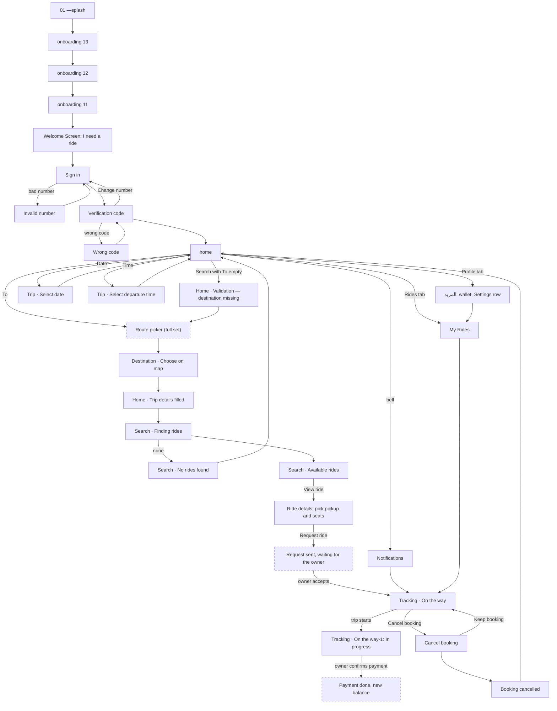
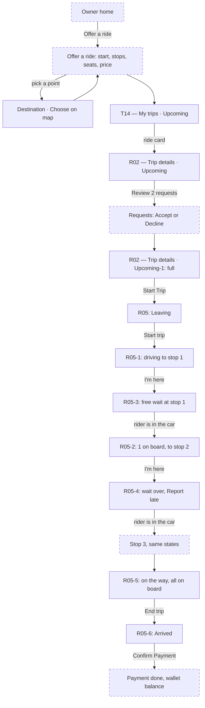

# Demo design flow (rider and owner)

Islam shared the demo designs on 2026-10-30: 26 rider files and 11 owner files, English and LTR only. They are a subset of the designs for one live demo of the full cycle. The images stay on Islam's Mac and are not in this repo, because the repo is public and the screens show sample faces, names and plates. This page maps both demo flows and how they meet. The demo is built on the real backend (plan 3.9). Islam's decisions for it are in plan 2.2. The full rider set is in [rider-flow.md](rider-flow.md).

## Full cycle

One owner and one rider, each on their own Android emulator, both on the local Firebase emulators.

## Rider demo flow

Dashed boxes are screens not in the demo folder. The route picker is in the full set; the others are built as `[FIGMA]` (plan rule 12).

## Owner demo flow

The R05 file numbers are out of order. The real order is base, -1, -3, -2, -4, -5, -6.

## Screen index

### Rider (26 files)

All rider files are also in the full set, except where the State column says otherwise.

| Design file | Screen | State | Task |
| --- | --- | --- | --- |
| 01 —splash | Splash | | P3-A09 |
| onboarding 13, 12, 11 | Onboarding pages 1, 2, 3 | same pages as 10, 9, 8 in the full set | P3-A09 |
| Welcome Screen | Welcome | rider picked | P3-A09 |
| Sign in / Invalid number | PhoneEntry | empty / error | P3-A09 |
| Verification code / Wrong code | OtpVerify | typing / error | P3-A09 |
| home / Home · Trip details filled / Home · Validation — destination missing | Home, rider | default / filled / error | P3-A09 |
| Trip · Select date / Trip · Select departure time | Date and time sheets | open | P3-A09 |
| Destination · Choose on map | MapPointPicker | point picked | P3-A09 |
| Search · Finding rides / Available rides / No rides found | SearchResults | loading / list / empty | P3-A09 |
| Ride details | RiderRideDetails | before the request | P3-A09 |
| Tracking · On the way / -1 | RiderTrip | confirmed / in progress | P3-A09 |
| Cancel booking / Booking cancelled | Cancel sheet | reason picked / done | P3-A09 |
| My Rides | Rides tab | one list, no tab row (new) | P3-A09 |
| Notifications | Inbox | list | P3-A09, P3-B06 |
| المزيد ("More") | Profile tab | wallet balance, toggle and language inline | P3-A09 |

### Owner (11 files)

These are the first owner designs. Plan 3.8 marks every owner screen `[FIGMA]`; these files now give the layout.

| Design file | Screen | State | Task |
| --- | --- | --- | --- |
| T14 — My trips · Upcoming | Rides tab (one list for both roles) | a booking and an own ride | P3-A10 |
| R02 — Trip details · Upcoming | HostRideDetails | 1 booked, 2 requests waiting | P3-A10 |
| R02 — Trip details · Upcoming-1 | HostRideDetails | full, Start Trip | P3-A10 |
| R05 — Trip day · Leave soon | HostTrip | Leaving | P3-A10 |
| R05 … -1 | HostTrip | driving to stop 1 | P3-A10 |
| R05 … -3 | HostTrip | at stop 1, inside the free wait | P3-A10 |
| R05 … -2 | HostTrip | rider 1 on board, driving to stop 2 | P3-A10 |
| R05 … -4 | HostTrip | at stop 2, wait over, Report late | P3-A10 |
| R05 … -5 | HostTrip | on the way, all on board | P3-A10 |
| R05 … -6 | HostTrip | arrived, Confirm Payment | P3-A10 |
| Destination · Choose on map | MapPointPicker inside Offer a ride | point picked | P3-A10 |

## Not designed, built as `[FIGMA]` for the demo

- Rider: choosing the pickup (start point or a stop) on Ride details, Request sent and waiting, Payment done, the "I'm at the pickup point" button (3.8 fix 8).
- Owner: Owner home, Offer a ride with stops, the Requests list with Accept and Decline, Payment done.
- Both: Arabic (RTL) screens. Strings still come in English and Arabic (rule 7).

## Where the demo designs differ, and what the app does

| Design shows | App does | Why |
| --- | --- | --- |
| A 250 EGP wallet on More | A real wallet: seed balance, admin top-up, paid by Confirm Payment | 2.2 #2 |
| "Pay the Hitchy fee", "Booking request sent", "Fuel share" | Plan texts (8.15) and the booking total | 2.2 #3, 3.8 fixes 2, 10, 11 |
| "Verified driver", "Your host", "hosts" | "Verified owner", "Your owner", "owners" | 2.2 #3, 3.8 fix 1 |
| Full names on cards, details, trip and lists | First names | 2.2 #3, 3.8 fix 5 |
| A free map pin, places outside the pilot zones | Fixed point pins from the pilot zones | 2.2 #3, 3.8 fix 3 |
| Notification toggle and language on More | A Settings row | 2.2 #3, 3.8 fix 18 |
| Each rider has their own pickup place and time | Ride stops; the rider picks one | 2.2 #4 |
| Free wait starts when the owner arrives | Same: "I'm here" starts it; "Report late" adds the fee | 2.2 #5 |
| One Rides list for both roles | Same | 2.2 #6 |
| "Expected EGP x · up to EGP y" | Same, shown on owner ride details | 2.2 #7 |
| One "Confirm Payment" for the whole ride | Same: it pays every boarded rider from their wallet | 2.2 #2 |
| "Start Trip" on a ride for tomorrow | Start only within 30 minutes of departure | `startRide` (8.7) |
| A route line that follows roads | Straight lines between points | 5.10 |
| Chat, call, Share trip, Report, Emergency | Not in the demo | Phases 8 and 13 |
| "Owner changed the time" as a cancel reason | The plan's reasons | 3.8 fix 7 |

## Design bugs to send to the designer

Rider (new, not in rider-flow.md):

- Home: a route line and a pin show while To is empty; the locate and layers buttons are missing.
- The bell badge says 1, but Notifications has 2 unread items. "Your ride is tomorrow" is older than "accepted". Times mix "7:30 AM" and "7:30".
- The Profile initials in the bottom bar don't match the name on More. The rider's rating on More is a copy of the owner's.
- The pickup has three different names across Home, the search cards and Tracking. The walk is 300 m on the card and 90 m on Ride details.
- Ride details and Tracking show different owners and cars. Tracking shows another time, 1 passenger instead of 2, and EGP 55 instead of EGP 144.
- My Rides: the "In progress" card is another route and time than the "In progress" Tracking screen.
- Choose on map: the pin sits by the "Nasr City" label, but the card says Smart Village.
- No rides found keeps the title "Available rides". Wrong code moves the "Resend code" line below the button.
- Sign in has a "Create an account" link, but there is no sign-up screen (sign-in creates the account).
- Still there: "1 passenger" while the stepper shows 2, "3 rides" with 2 cards, the ",,," placeholder, the "Confirmed" card behind Booking cancelled, "In progress" still shows Cancel booking, the "For today…" note on tomorrow, the onboarding word breaks, iOS status bars.

Owner:

- "Up Coming Trips" is the title of the list and of the ride details. It should be "Upcoming trips" and "Trip details".
- R02-1 still says "1 of 3 booked" and "Posted" with 3 riders. R05-6 still says "3 on board" after drop-off.
- Initials don't match the names (the same initials on every row).
- Pickup times and gates differ between R02-1 and R05, and the rider order changes.
- T14 cards don't match R02 or R05 (route, day and status). Nasr City is not a pilot zone. One card says "Pickup", the other "Start". T14 shows a back arrow and the bottom bar together, and it is exported at 1x.
- R05: "Leave in 15 min" while the car is already on the route; the same map in all seven states; the button still says "Start trip" while driving; "Next" is vague; "Pickups" vs "At pickups" and "Free wait · 5 min" vs "Free wait over 5 min"; is the light "in the car" button disabled?
- Stray dots ("On board . late", "EGP 56 . Fair price") and mixed capitals ("2 seats Open", "Start Trip" vs "Start trip").
- All seven R05 files are named "Leave soon". The frames are taller than the screen, so the main button sits below the fold.
- Missing states: the third pickup, no show, request expired or declined, rider cancelled, empty list, loading, error, Arabic (RTL).
