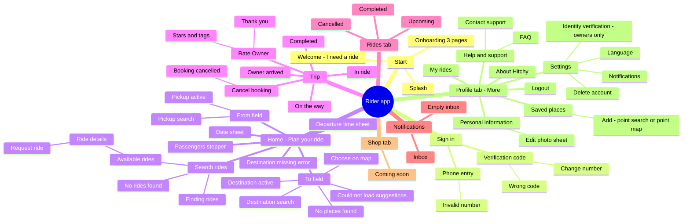
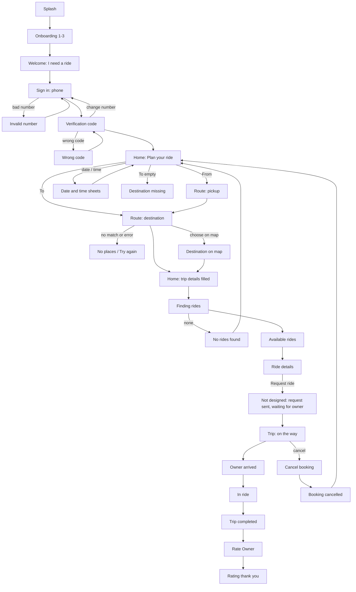

# Rider design flow

Islam shared the full rider design set on 2026-10-30: 57 PNG files, English and LTR only. This is the full flow, not the demo. The images stay on Islam's Mac and are not in this repo, because the repo is public and some screens show sample faces, names and plates. This page lists every screen and maps the rider's path through the app. Plan section 3.8 maps each file to a screen and task and holds the fix list. Where the designs disagree with the plan, Islam's decisions are under "Decisions" at the end (also in ADR 0004).

## Mind map

## Main path

## Screen index

"In 3.8" says whether the plan's screen map (46 files, reviewed 2026-10-29) already lists the file.

| Design file | Screen | State | In 3.8 |
| --- | --- | --- | --- |
| 01 —splash | Splash | | yes |
| onboarding 10, 9, 8 | Onboarding pages 1, 2, 3 | | yes |
| Welcome Screen | Welcome (rider or owner) | rider picked | yes |
| Sign in / Invalid number | PhoneEntry | empty / error | yes |
| Verification code / Wrong code | OtpVerify | typing / error | yes |
| home / Home · Trip details filled / Home · Validation — destination missing | Home, rider | default / filled / error | yes |
| Route · Pickup active, Route · Pickup search | RoutePicker, From | focused / results | yes |
| Route · Destination active, Route · Destination search | RoutePicker, To | focused / results | yes |
| Route · Destination search-1 / -2 | RoutePicker, To | no places / network error | yes |
| 5 · Combined route picker — From & To on one screen | Section label, not a screen | | yes |
| Destination · Choose on map | MapPointPicker | point picked | yes |
| Trip · Select date / Trip · Select departure time | Date and time sheets | open | yes |
| Search · Finding rides / Available rides / No rides found | SearchResults | loading / list / empty | yes |
| Ride Result Card | Ride card component | | yes |
| Ride details | RiderRideDetails before booking | | yes |
| Tracking · On the way / -2 / -3 | RiderTrip | on the way / arrived / in ride | yes |
| Tracking · On the way-1 | RiderTrip, older layout | | yes |
| Tracking · Completed | RiderTrip, completed | | **new** |
| Cancel booking / Booking cancelled | Cancel sheet | reason picked / done | yes |
| Rate Owner · Empty / Selected, Rating thank you | RateTrip | empty / filled / done | yes |
| My Rides / Rides Screen / My rides · Past | MyTrips (Rides tab) | Upcoming / Completed / Cancelled | yes |
| My Rides-1 / Rides Screen-1 / My rides · Past-1 | MyTrips opened from Profile (Back, no bottom bar) | same three tabs | **new** |
| Notifications / Notifications · Empty | Notifications inbox | list / empty | yes |
| shop | Shop tab | coming soon | yes |
| Toggle | `HitchySwitch` component | off | yes |
| المزيد ("More") | Profile tab hub | | **new** |
| Personal Information / -1 | Profile edit / photo sheet | filled / sheet open | **new** |
| Saved Places | Saved places list | two places | **new** |
| Map / Add Address | Add a saved place: map, then form | | **new** |
| About App | About Hitchy | placeholder text | **new** |
| Hitchy Mobile App Screens (Copy) | Help and support (FAQ) | one answer open | **new** |
| Hitchy Mobile App Screens (Copy)-1 | Contact support sheet | empty form | **new** |
| Settings | Settings (verification, privacy, safety, delete account) | opened from a row in Profile | **new** |

In 3.8 but not in this folder: Search · Filters & sort, Upcoming ride details (and -1), Fuel Share Receipt.

## Not designed yet

- Request sent and waiting for the owner to accept (plan 2.1: the owner accepts each booking).
- Payment confirmation, Receipt, Chat, Call, Share trip, Report, the Emergency (SOS) sheet.
- What "Report a Safety Concern" in Help opens (still to decide).
- Profile setup after the first sign-in, Terms and Privacy pages, the filter sheet, the pickup map.
- Every owner screen, and every Arabic (RTL) screen.

## Design bugs to send to the designer

- Home: the stepper shows 2 but the label says "1 passenger".
- Destination search -1 / -2: the message text doesn't match the field ("Maadxz"; "pickup" while editing To).
- Available rides: header says 3 rides but 2 cards show; initials don't match the name; seat dots don't match "2 seats left".
- Ride details: the info box holds placeholder text ",,,".
- Tracking -2: the "Arrived" step is not highlighted. Tracking -3: "Cancel booking" still shows during the ride.
- Booking cancelled: the card behind the sheet still says "Confirmed".
- Rate Owner · Selected: Submit still looks disabled.
- Add Address: all five fields are labelled "Home Area", there is no Save button, and the map style doesn't match the app's map.
- About App: placeholder text.
- Sample faces: confirm they are licensed or generated, or swap them for neutral avatars.

## Decisions (Islam, 2026-10-30)

| # | Design shows | Decision | Where in the plan |
| --- | --- | --- | --- |
| 1 | Saved places with a free address and a free map pin | Fixed points only. "Add" opens the point search and point-pin map; no address fields | 3.8 fix 17, P7-A02 |
| 2 | A "250 EGP" wallet in the Profile tab | Changed the same night for the demo: a real wallet now, paid by the owner's Confirm Payment (plan 2.2 #2, [demo-flow.md](demo-flow.md)). The first decision was no wallet at launch | R19, 3.8 fix 18, 2.2 |
| 3 | "Pay the Hitchy fee" and "Booking request sent" in Notifications | Keep the plan's texts (8.15) | 3.8 fixes 2 and 11 |
| 4 | A comment box in Rating, "Track ride" on the thank-you screen | Stars and tags only; the thank-you screen ends with "Done" | 3.8 fix 9 |
| 5 | "Verified driver" | "Verified owner" | 3.8 fix 1 |
| 6 | Settings with no way in | A Settings row in the Profile tab; the notification toggle and language move into Settings. Identity Verification shows in owner mode only. Privacy Settings and Safety Center are `[LATER]` | 3.8 fixes 18 and 19, P4-A04 |
| 7 | New Profile, Settings, Saved places, Help, Contact support and About screens | Mapped in 3.8. The FAQ is a fixed list in string resources. Contact support saves the request in Firestore through a new callable `contactSupport`, read by admins in the admin web; its details are asked when P13-B06 starts | 3.8, P4-A04, P7-A02, P13-B06, P13-A05, P13-W03 |
